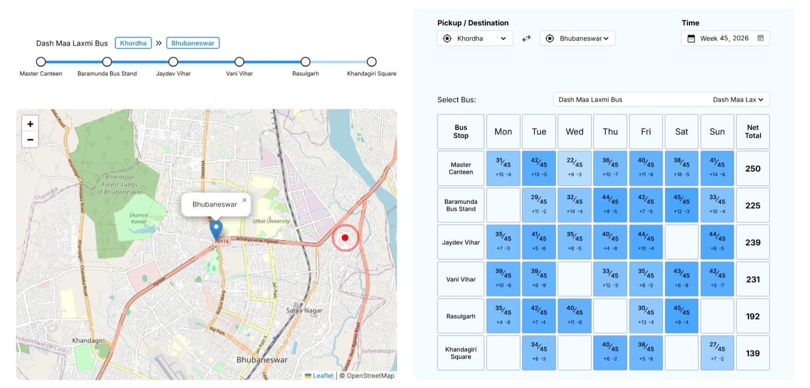

# Vissora
### Edge AI Person Tracker for Buses and Public Places with an Interactive Dashboard

Vissora is an Edge AI-powered person tracking and monitoring system designed for public transportation and public spaces. It provides person detection, tracking, passenger movement analysis, and an interactive dashboard for visualizing collected data.

Developed for **OSFIC (Odisha State Faculty Innovation Challenge)**, Vissora aims to improve passenger monitoring and transportation analytics through edge computing and AI-based vision systems.



## Features

- **AI-Based Person Detection:** Detects people in video streams using an AI detection model.
- **Person Tracking:** Tracks detected individuals across video frames.
- **Interactive Dashboard:** Provides a visual interface for monitoring and analyzing passenger-related information.
- **Virtual Detection Environment:** Supports running the detection system virtually on Windows without requiring physical edge hardware.
- **Passenger Analytics:** Provides an overview of passenger movement and related transportation data.
- **Edge Deployment Architecture:** Designed to support deployment on Raspberry Pi-based edge devices.

## Project Structure

```text
Vissora/
├── server/
│   └── main.py
├── web/
│   └── index.html
├── Makefile
└── README.md
```

*The above represents the main project components; additional files and directories may exist.*

## Requirements

- Windows x64 (for the virtual detector executable)
- Python
- Flask
- A modern web browser

## Running the Project

### 1. Run the AI Detector

The virtual detector currently supports **Windows x64 only**.

A precompiled executable is provided as a ZIP archive in the GitHub Releases section.

1. Open the repository's Releases page.
2. Download the Windows x64 executable ZIP.
3. Extract the archive.
4. Run the executable.

Alternatively, to build the detector from source, use the provided `Makefile`:

```bash
make
```

### 2. Run the Backend Server

Install Flask:

```bash
pip install flask
```

From the project root directory, execute:

```bash
python server/main.py
```

This starts the backend server.

### 3. Run the Dashboard

Serve the `web` directory through a local HTTP server.

For example, using Python:

```bash
python -m http.server 8000 --directory web
```

Open the following address in your browser:

```text
http://localhost:8000
```

The dashboard will be accessible through the local server.

## Dataset and Storage

For demonstration and evaluation purposes, Vissora currently uses **dummy datasets**.

JSON files are used to store and organize the sample data, making it easier to inspect the dataset structure and understand the system's data flow.

For production deployment, the storage layer is intended to be migrated to **PostgreSQL** to provide a more robust and scalable database solution.

**Important:** The datasets currently included are illustrative and do not represent actual OSRTC passenger records or live transportation data.

## Hardware Deployment (Planned)

For real-world deployment, Vissora is designed around edge devices installed inside buses.

The proposed hardware configuration includes:

- Raspberry Pi as the edge computing device.
- GPS module for geographical location tracking.
- Camera module for capturing passenger movement.
- Edge AI inference for person detection and tracking.

The edge device will process camera feeds and support the collection of passenger movement information. GPS data will provide geographical context for the collected events.

This architecture is intended to enable bus-level passenger monitoring and centralized dashboard visualization.

## Technology Stack

| Component | Technology |
|---|---|
| AI Detection | Computer Vision / Edge AI |
| Virtual Detector | Windows x64 Executable |
| Backend | Python, Flask |
| Frontend | HTML, CSS, JavaScript |
| Demonstration Storage | JSON |
| Planned Production Database | PostgreSQL |
| Planned Edge Hardware | Raspberry Pi, GPS, Camera |

## Copyright and Usage Restrictions

**Copyright © 2026 AnvLabs. All Rights Reserved.**

This project, including its source code, architecture, implementation, and associated materials, is proprietary.

Permission to access, use, modify, or maintain this source code is granted exclusively to **OSFIC and its authorized representatives** for the purposes of evaluating, reviewing, and further developing the Vissora project in connection with OSFIC.

No other individual, organization, or third party is permitted to:

- Copy or reproduce the source code.
- Redistribute or republish the project or its components.
- Use the code in other projects or commercial products.
- Modify, sublicense, or create derivative works.
- Claim ownership or authorship of the original implementation.

Any rights beyond the limited permission granted to OSFIC require prior written authorization from AnvLabs.

**Unauthorized use, reproduction, modification, or distribution is prohibited.**

---

*Developed for OSFIC | Vissora – Edge AI Person Tracking System*
